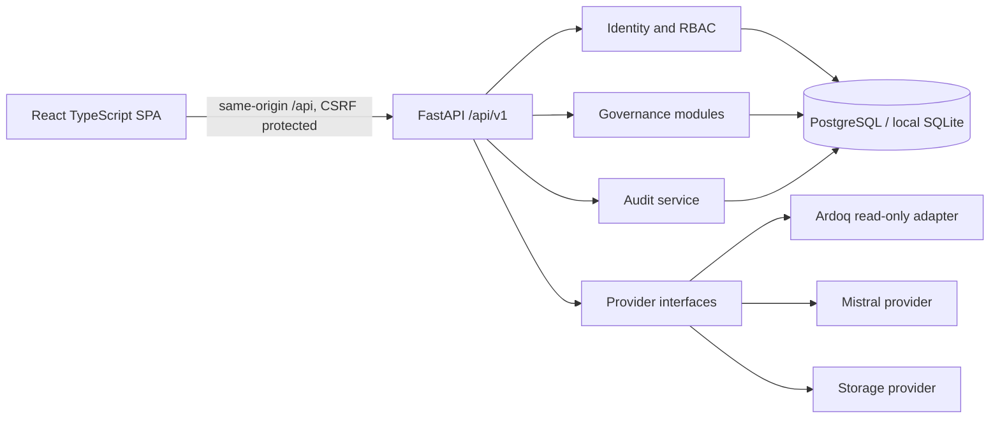
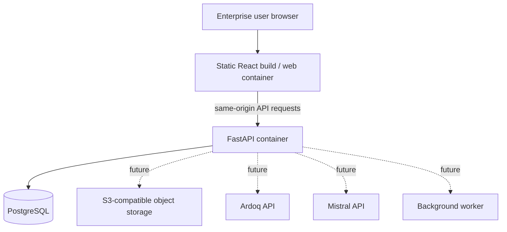
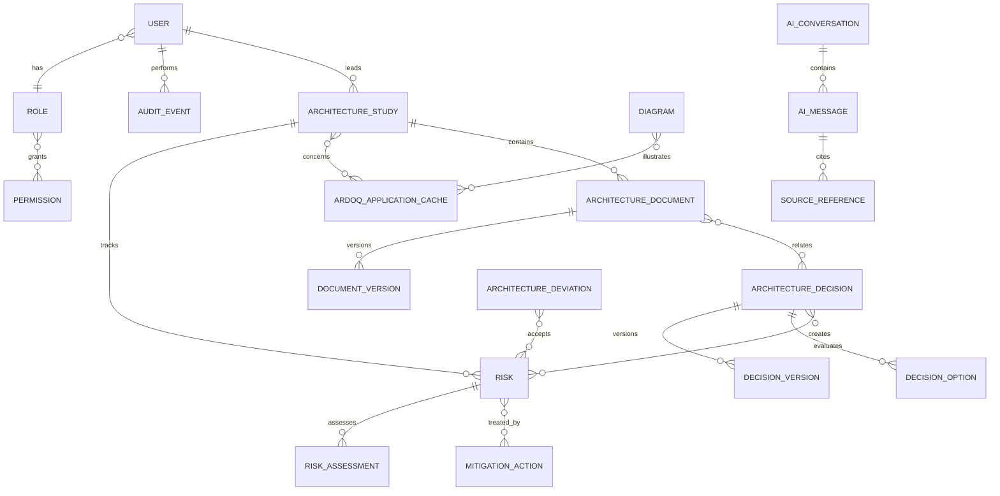

# Architecture and Foundation Decisions

## Business objective

Provide Enterprise Architects a permission-aware workspace to connect studies and evidence with decisions, risks, mitigations, documents, diagrams and portfolio applications. The workbench is the governance and traceability layer; Ardoq remains the authoritative application portfolio. Core governance must continue when AI or Ardoq is unavailable.

## Module map

The planned modular monolith has bounded modules for identity, users, studies, decisions (ADR), risks, mitigations, deviations, documents (ADD), diagrams, applications, Ardoq integration, AI assistant, search, reporting, notifications, audit and administration. Each module owns its domain rules, application services, repository boundary, schemas, routes and tests. Cross-module relationships use explicit association tables and application services, not direct cross-module persistence access.

Increment 1 implements identity, users, audit, health and dashboard boundaries. Increment 2 implements studies, scored risks, ADRs with review/version history, and a persistent source-citing assistant backed by permission-aware retrieval. Mitigation actions and their relationships remain pending within Core Governance.

## Component architecture



The API is the trust boundary. Browser code never receives integration credentials. Provider interfaces isolate external API schemas. Increment 1 has no external integration configured.

## Deployment architecture



Production ingress terminates TLS, serves the frontend and routes `/api` to the backend on the same origin. Compose is a development starting point, not a hardened production deployment.

## Initial entity relationship model



This is the target normalized model, not a claim that all entities ship yet. Implemented tables include identity/audit, ArchitectureStudy, ArchitectureRisk, ArchitectureDecision, DecisionOption, DecisionVersion, decision-study/risk joins, AIConversation, AIMessage and SourceReference. Studies, risks and ADRs include optimistic row versions.

## Permissions matrix

| Capability | Administrator | Enterprise Architect | Solution Architect | Technical Architect | Reviewer / ARB | Read-only |
|---|---:|---:|---:|---:|---:|---:|
| Manage users and reference data | Yes | No | No | No | No | No |
| Manage studies and author artefacts | Yes | Yes | Contribute | Contribute | No | No |
| Review assigned submissions | Yes | Submitter excluded by workflow | Assigned only | Assigned only | Assigned only | No |
| Accept/reject decisions and residual risks | Yes | Per authority assignment | No | No | Assigned authority | No |
| Read approved, authorized records | Yes | Yes | Yes | Yes | Yes | Yes |
| View audit events | Yes | Own/authorized scope | Own/authorized scope | Own/authorized scope | Own/authorized scope | No |
| Configure Ardoq/Mistral providers | Yes | No | No | No | No | No |

Future modules must enforce object-level authorization and assignment rules; role membership alone is not enough for restricted records. ADR and assistant endpoints enforce read/write/review/use permissions. Restricted studies are filtered from ADR links and assistant retrieval unless the user is their lead architect or an administrator. User/audit administration remains administrator-only.

## API contracts (Increment 1)

All routes are under `/api/v1`. Lists return `items`, `total`, `limit`, `offset`; `limit` is capped at 100. Inputs are schema validated.

| Method and path | Access | Contract |
|---|---|---|
| `GET /health/live`, `GET /health/ready` | Public | Liveness; readiness includes database connectivity. |
| `GET /api/v1/auth/csrf` | Public | Returns CSRF token and sets CSRF cookie. |
| `POST /api/v1/auth/login` | CSRF + public | `{email,password}`; sets HTTP-only access cookie and returns profile. |
| `POST /api/v1/auth/logout` | CSRF + authenticated | Clears session cookie. |
| `GET /api/v1/auth/me` | Authenticated | Current profile and role. |
| `GET /api/v1/users` | Administrator | Paginated user directory. |
| `GET /api/v1/users/roles` | Administrator | Assignable roles. |
| `POST /api/v1/users` | Administrator + CSRF | Creates user with role and temporary password. |
| `GET /api/v1/audit-events` | Administrator | Newest-first paginated events. |
| `GET /api/v1/dashboard` | Authenticated | Database-derived study and open/critical risk counts. |
| `GET /api/v1/studies` | `studies.read` | Paginated studies. |
| `POST /api/v1/studies` | `studies.write` + CSRF | Creates a draft; lead architect is current user. |
| `GET /api/v1/studies/{id}` | `studies.read` | Study detail. |
| `PATCH /api/v1/studies/{id}` | `studies.write` + CSRF | Partial update with lifecycle validation and optimistic row version. |
| `DELETE /api/v1/studies/{id}` | `studies.write` + CSRF | Deletes draft studies only. |
| `GET /api/v1/risks` | `risks.read` | Paginated register with calculated scores and criticality. |
| `POST /api/v1/risks` | `risks.write` + CSRF | Creates risk for current owner; validates 1–4 scores and optional study reference. |
| `GET /api/v1/risks/{id}` | `risks.read` | Risk detail including calculated scores. |
| `PATCH /api/v1/risks/{id}` | `risks.write` + CSRF | Partial update with lifecycle validation and optimistic row version. |
| `GET /api/v1/decisions` | `decisions.read` | Paginated/searchable ADR register. |
| `POST /api/v1/decisions` | `decisions.write` + CSRF | Creates a draft ADR, options, links and initial version. |
| `GET /api/v1/decisions/{id}` | `decisions.read` | ADR detail and current ETag. |
| `PATCH /api/v1/decisions/{id}` | `decisions.write` or `decisions.review` + CSRF + `If-Match` | Validates workflow and approval rules; accepted edits create an immutable version. |
| `GET /api/v1/decisions/{id}/versions` | `decisions.read` | Immutable version snapshots. |
| `GET /api/v1/decisions/{id}/compare` | `decisions.read` | Field-level version comparison. |
| `GET /api/v1/ai/conversations` | `assistant.use` | Authenticated user's conversations only. |
| `GET /api/v1/ai/conversations/{id}` | Owner + `assistant.use` | Conversation and source references; other users receive 404. |
| `POST /api/v1/ai/ask` | `assistant.use` + CSRF | Retrieves authorised records, calls server-side Mistral, persists answer/sources and audit metadata. |

Risk criticality bands are 1–3 Low, 4–7 Medium, 8–11 High and 12–16 Critical. Multiplication and classification run in the backend domain model, never in the browser.

## Integration strategy

- **Ardoq:** `ArdoqProvider` isolates application search/details, relationships, components, interfaces, owners and health. The future MVP adapter is read-only, paginated, timeout/retry/rate limited and backed by a timestamped cache. Outage responses use cached data only with freshness indicated; never synthesize portfolio data. Credentials stay server-side.
- **Mistral:** `MistralProvider` and `EmbeddingProvider` are backend-only. Retrieval checks permissions before context construction. Imported content is untrusted; prompt injection is mitigated. Responses cite typed sources and distinguish verified facts, retrieved sources, recommendations, assumptions and open points. Generated artefacts remain drafts. Embeddings and AI-generated artefacts are still future work.
- **Mistral:** `MistralProvider` is backend-only and configured through `EA_MISTRAL_API_KEY`, `EA_MISTRAL_BASE_URL`, and `EA_MISTRAL_MODEL`. Current MVP retrieval uses lexical matching across authorised studies, ADRs and risks, with per-user conversation ownership and persisted source references. Imported text is delimited as untrusted context; instructions embedded in it are explicitly ignored. An exact no-source response is returned when retrieval finds nothing. Embeddings/vector search, richer retrieved-content sanitisation and generated draft artefacts remain future work.
- **Draw.io:** `DrawioProvider` preserves editable Draw.io XML; image exports are derived. Import/export is the fallback if embedding is unavailable. Mermaid remains document content.
- **Other interfaces:** Storage, search, notifications, identity, background jobs and metrics receive adapters in later increments.

## Security assumptions and unresolved decisions

- Local password/JWT auth is development-only. Production requires OIDC, enterprise MFA, identity lifecycle and conditional access.
- The short-lived access token is in an HttpOnly, SameSite=Strict cookie. Mutations require matching CSRF cookie and header. Production requires TLS and `EA_COOKIE_SECURE=true`, same-origin ingress and restrictive CSP.
- Passwords use Argon2. Signing keys/bootstrap credentials come from environment or secret management. Never commit secrets.
- RBAC is server enforced. Every future object, search, export and AI retrieval query requires object-level scope checks to prevent IDOR and cross-user context leakage.
- Imported files and integration content are untrusted. Markdown sanitization, file type/size limits, malware scanning, rate limiting and retention policies need implementation/configuration before production.
- Audit records actor, UTC timestamp, action, object, before/after data and origin. Secrets and passwords must never be recorded.
- Unresolved: corporate OIDC claims; official approved CMA CGM theme tokens; Ardoq API/service-account scopes; Mistral model, region and retention; data classification/retention; object store, notifications, metrics and malware scanner.

## Repository structure

```text
backend/app/core/                 configuration, database, security, dependencies
backend/app/{identity,users,audit,dashboard}/  implemented module packages
backend/migrations/               Alembic revisions
backend/tests/                    backend and authorization checks
frontend/src/                     React routes, API client, i18n and theme
docs/                             architecture and operational runbook
deploy/                           web-server routing configuration
```